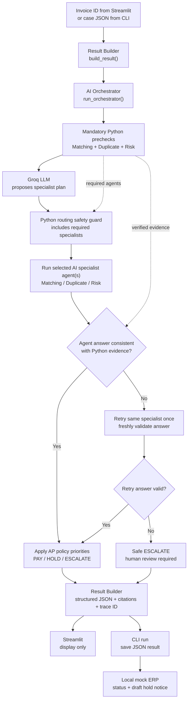
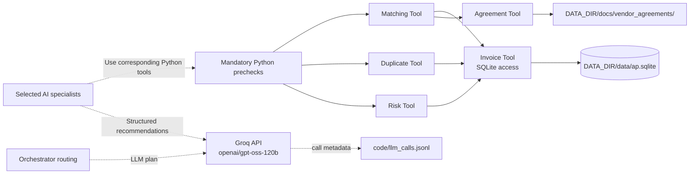

# Invoice Exception Desk — Agent, Tool and Data Architecture

**AZ4C Associate Engineer | Use Case 1 | Part A**

This system combines **LLM-based dynamic specialist selection** with **mandatory deterministic Python evidence checks**. The Orchestrator never permits an LLM recommendation to override the Python evidence or the company's AP policy.

## Main execution and retry flow

**Retry semantics:** An invalid, inconsistent, or failed specialist answer is retried **once** (at most two specialist attempts). The second result is independently checked. A persistent mismatch results in `ESCALATE`, not an unsupported `PAY`. This retry invokes the specialist again using its existing prompt; it does **not** currently pass a detailed corrective prompt into that specialist.

## Tools and data access

The **Matching, Duplicate and Risk Python tools** establish authoritative financial and risk evidence; selected **LLM agents** interpret that evidence. Matching also uses signed vendor price agreements where applicable. The company AP policy guides deterministic final decision rules. Vendor covering emails are part of the external pack but are **not claimed as a complete automated email-ingestion pipeline**.

## Responsibilities

| Component | Role |
|---|---|
| `result_builder.py` | Entry to the investigation and assembly of schema-aligned result JSON, citations and trace ID |
| `orchestrator.py` | Three Python prechecks; Groq routing proposal; mandatory-agent guard; specialist execution; evidence validation; one corrective attempt; final policy decision |
| `matching_agent.py` | LLM specialist for invoice/PO/GRN and price investigation |
| `duplicate_agent.py` | LLM specialist for duplicate/payment investigation |
| `risk_agent.py` | LLM specialist for GST, vendor blocking and bank-change risks |
| `matching_tool.py`, `duplicate_tool.py`, `risk_tool.py` | Deterministic evidence checks |
| `invoice_tool.py` | Local SQLite data access using `DATA_DIR` |
| `agreement_tool.py` | Applicable signed vendor-agreement price evidence |
| `llm_client.py` | Groq calls, structured-response handling, API retry behavior and per-call metadata logging |
| `mock_erp.py` | Local CLI-side ERP status save and draft notice for holds |

## Routing and safety details

1. **Every valid invoice gets all three Python prechecks** before an LLM chooses specialist agents. Python prechecks are not the same as Groq-powered specialist agent calls.
2. The **Groq Orchestrator** proposes agents from verified precheck results; a **Python guard** ensures no specialist required by an observed exception can be omitted.
3. The system executes **only selected specialists**. A clean invoice normally selects Matching, while combined exceptions can select Duplicate and Risk together.
4. Each AI recommendation is checked against **fresh Python tool evidence**, including invoice ID and specialist identity. If the first attempt fails, that specialist is invoked once more and checked again.
5. Python applies documented exception precedence: `DUPLICATE` > `VENDOR_BLOCKED` > `BANK_CHANGE_RISK` > `UNKNOWN_PO` > `MISSING_GRN` > `QTY_SHORT` > `PRICE_VARIANCE` > `GST_MISMATCH`.
6. Missing or invalid evidence, unresolved specialist errors and unsafe recommendations cannot become an automatic pay decision. Holds and escalations, and payments above ₹5 lakh, require a **human-review flag**.
7. The **CLI** saves the decision to a JSON output and a mock ERP file at `DATA_DIR/mock_system/erp_payment_status.jsonl`. Identical invoice status/reason/human-review combinations are not appended twice. A held invoice produces or refreshes `DATA_DIR/mock_system/outbox/<invoice_id>.md`.
8. **Streamlit displays** the investigation; it does not perform the CLI's mock ERP save. There is no live payment processing, vendor email transmission, or interactive Part B approval workflow.

## Execution examples (local tests)

| Case | Detected evidence | Specialist(s) selected |
|---|---|---|
| Clean invoice | Matching `MATCH`, Duplicate `CLEAR`, Risk `CLEAR` | Matching |
| Quantity shortage | Matching `HOLD` | Matching |
| Duplicate payment | Duplicate `DUPLICATE` | Duplicate |
| Duplicate + blocked vendor | Duplicate `DUPLICATE`, Risk `RISK` | Duplicate + Risk |

The diagram is intentionally simplified to show the **control flow**, while the second diagram shows the **tool/data dependencies**. It does not imply that all three AI specialists execute on every invoice.
