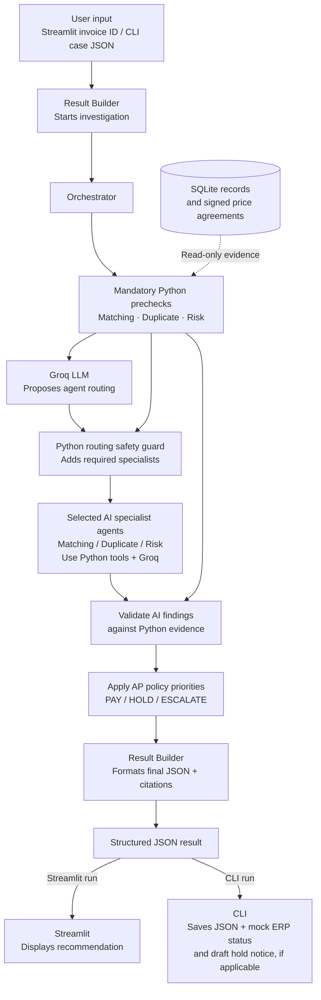

# Invoice Exception Desk — Architecture

The application uses **hybrid dynamic routing**. All three **Python evidence checks** run for every valid invoice; only the **AI specialist agents selected for that invoice** run. A Python safety guard ensures the AI routing proposal cannot skip a specialist required by detected exceptions.

## How to read the diagram

1. **Entry:** Streamlit accepts an invoice ID, or the CLI reads a case JSON. Both call `result_builder.build_result()`.
2. **Evidence:** The Orchestrator invokes the three mandatory deterministic tools: `matching_tool`, `duplicate_tool`, and `risk_tool`. They use `invoice_tool` / SQLite records; matching also checks applicable signed agreements through `agreement_tool`.
3. **Dynamic routing:** Groq proposes a specialist-agent selection from the verified precheck findings. Python ensures specialists required by detected exceptions are included. Clean invoices still get a specialist review.
4. **Specialists:** Only selected agents run. Each specialist calls its Python evidence tool and uses Groq to generate a structured recommendation and explanation.
5. **Safety and policy:** The Orchestrator validates agent recommendations against Python evidence and applies the documented AP exception-priority rules. Unreliable findings fail safe to escalation.
6. **Output:** `result_builder.py` formats JSON with the decision, reason, amount, citations, human-review flag, and trace ID. Streamlit displays it; the CLI saves a JSON result and writes simulated mock-ERP records and applicable draft notices.

**Notes:** The two Result Builder boxes refer to **the same `result_builder.py` module** at the beginning and end of the investigation. The diagram simplifies the specialist agents' internal tool and Groq calls to keep the main control flow readable. No real payment is released and no vendor email is sent.
