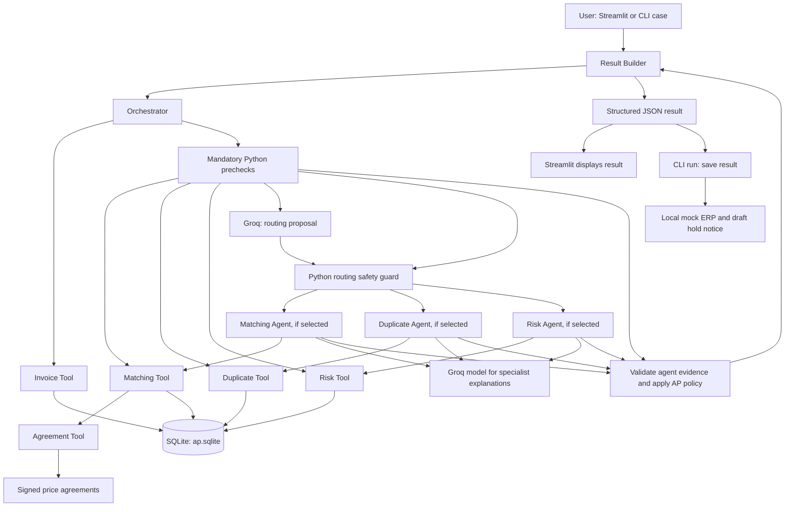

# Invoice Exception Desk — Architecture

The runtime uses hybrid dynamic routing: mandatory deterministic checks establish evidence, while a Groq LLM proposes relevant specialist AI agents. Python routing safety rules prevent critical exception areas from being skipped.

The Mermaid diagram is rendered in GitHub Markdown. All three Python prechecks execute on each valid invoice; the specialist LLM agents execute only when selected. The mock ERP and notice output are local simulations, not real financial actions.
